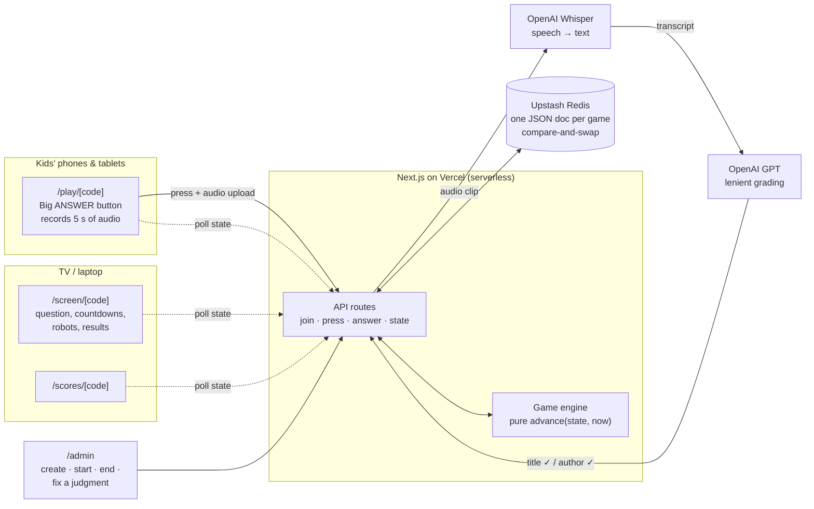

# 📚 Battle of the Books Trainer

**Play it here: <https://battle-of-the-books-three.vercel.app/>**

## Why I built this

My 9-year-old son and his friends are competing in **Battle of the Books** at school. In this reading
competition, teams of kids hear a question about one of the books on their reading list and race to
name the book and its author.

They had read the books. What they lacked was practice at the competition itself: hearing a question,
pressing the button before the other team, and saying the answer quickly. Quizzing them by hand with
index cards doesn't create that pressure, so I built this app.

The kids play together as one team against a team of robots. Each kid joins from their own phone or
tablet and presses a big button to answer, then says the answer out loud. The app turns the speech
into text and grades it. Meanwhile the robots buzz in on a timer, so the kids have to be fast. Once I
start a game, it runs from question to question without me.

## What's in it

| Mode | Where | What it does |
|---|---|---|
| **Team game** | `/admin`, `/play/[code]`, `/screen/[code]`, `/scores/[code]` | The main event. The kids answer as one team against the robots, with a TV or laptop as the big screen. |
| **Practice** | `/practice` | One kid alone, no robots, no time pressure. Shows the right answer after each miss so they learn it. |
| **Title & Author Quiz** | `/quiz` | Flashcards: given an author, name the book, or given a book, name the author. |
| **Leaderboard** | `/` | Practice scores, with extra weight for the harder question sets. |

### How a team game works

1. I log in to `/admin` and create a game. I choose the team name, the difficulty and the number of
   questions, and the app gives me a short game code like `OWL42`.
2. I open `/screen/OWL42` on the TV. It shows a QR code, and the kids scan it to join on their phones.
3. I press **Start**, and from there the game runs itself:
   - A question appears and every kid's button goes live.
   - The first kid to press answers for the team. Everyone else can still answer for 10 seconds for
     their own score.
   - If no kid presses before the robots' timer runs out, the robots answer. If the robots get it
     wrong, the kids can steal.
   - The big screen reveals the answer, and the next question starts on its own.
4. `/scores/OWL42` shows the team score against the robots and each kid's own stats.

**Scoring:** book and author correct is **+2**, book only is **+1**, a wrong answer is **−0.5**, and
pressing without saying anything is **0**.

**Difficulty** sets how fast the robots buzz in:

| Difficulty | Robots buzz after | Question set |
|---|---|---|
| Easy | 7 s | `questions/questions.md` |
| Medium | 5 s | `questions/questions.md` |
| Hard | 5 s | `questions/hard.md` |
| Super Duper Hard | 4 s | `questions/super duper hard.md` |
| Rishi Mode | 4 s | `questions/rishi mode.md` |

## How it works



### Technologies

- **Next.js (App Router) + TypeScript.** One app serves the pages and the API routes.
- **Tailwind CSS v4.** Big, bright, kid-friendly layouts, tuned separately for phones (landscape
  first), tablets and laptops.
- **Vercel.** Hosting. Serverless functions can't run timers, so the game engine doesn't use any.
  Every request first catches the game up to the current server time and then applies the action.
  Because every screen polls about once a second, the game always moves forward on time without a
  background process.
- **Upstash Redis.** Stores each game's state. Every write uses a compare-and-swap on a version
  number, so when two kids press at nearly the same moment, the server decides who was first. When no
  Redis is set up, the app uses an in-memory store for local development.
- **OpenAI Whisper.** Transcribes each 5-second answer. I pass it the list of book titles and authors
  as a hint, which makes it much better at spelling them.
- **OpenAI GPT (`gpt-4o-mini` by default).** Grades each transcript against the expected book and
  author. Grading is deliberately lenient because the speaker is a kid talking fast: misheard names,
  partial titles and a last name alone all count. Clear matches skip the model call entirely.
- **Browser `MediaRecorder`.** Captures audio only while a kid is answering. The microphone is off the
  rest of the time.
- **Zod** validates every request and the question files. **Vitest** tests the game engine.

## Running it yourself

### 1. Install and start

```bash
npm install
cp .env.example .env.local
npm run dev
```

Open <http://localhost:3000>. Out of the box, `.env.example` sets `MOCK_AI=true` and `STORE=memory`.
In that setup the kids type their answers instead of speaking them and no API keys are needed, which
is handy for trying out the flow.

### 2. Configure `.env.local`

| Variable | What it's for |
|---|---|
| `OPENAI_API_KEY` | Transcription and grading. Kept on the server only. |
| `OPENAI_TRANSCRIBE_MODEL` | Defaults to `whisper-1`. |
| `OPENAI_JUDGE_MODEL` | Defaults to `gpt-4o-mini`. |
| `ADMIN_PASSWORD` | Password for `/admin`. The admin page stays locked until it is set. |
| `UPSTASH_REDIS_REST_URL` / `UPSTASH_REDIS_REST_TOKEN` | Redis. `KV_REST_API_URL` / `KV_REST_API_TOKEN` from the Vercel integration also work. |
| `STORE` | `memory` forces the in-memory store. |
| `MOCK_AI` | `true` replaces the microphone with a text box and uses simple matching instead of OpenAI. |

Microphones need HTTPS. To test on real phones over your home Wi-Fi, run
`npx next dev --experimental-https` or use a Vercel preview deployment.

### 3. Add your own questions

Questions live in Markdown tables in `questions/`. To change them, edit the file and redeploy:

```markdown
| Question | Book Title | Author |
|---|---|---|
| In which book does a boy dig holes at a camp in the desert? | Holes | Louis Sachar |
```

`questions/questions template.md` is a blank file to start from. Text outside the table is ignored. If
a row is malformed, the app reports its line number so you can find and fix it.

### 4. Deploy

1. Push the repo to GitHub and import it into Vercel.
2. Add **Upstash Redis** from the Vercel Marketplace.
3. Set `OPENAI_API_KEY` and `ADMIN_PASSWORD` in the project's environment variables.
4. Deploy, then open `/admin` to create the first game.

### Commands

```bash
npm run dev      # local dev server
npm test         # engine and parser tests (Vitest)
npm run lint
npm run build
```
